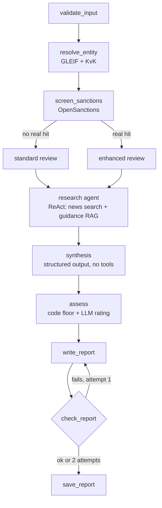

# Vendor Due-Diligence Agent

A LangGraph agent that checks a company before it becomes a vendor. It identifies the legal entity in public registers, screens it against sanctions lists, researches adverse media, and writes a due-diligence report with a risk rating and a recommendation, backed by AML and sanctions guidance retrieved with RAG.

It can be run from the terminal, a Streamlit app, a REST API, or an n8n form.

> This is an automated pre-screening to support, not replace, a compliance officer. It is not legal advice.

## What a report contains

1. Summary and risk rating (Low / Medium / High)
2. Identity: legal name, LEI, country, address, status, KvK number
3. Ownership: direct and ultimate parent
4. Sanctions screening: every name screened, hits with score, programs and country
5. Adverse media: findings with year, category and source
6. Red flags: severity, evidence, source and the guidance passage behind it
7. Recommendation: Onboard, Onboard with conditions, Escalate or Do not onboard, with next steps
8. Data limitations and disclaimer

Sample reports are in [`reports/`](reports/) (the `final_*` files).

## How it works



**The LLM is used where judgement is needed, and the code is used where it must be right.**

- **Code:** entity resolution, sanctions matching, and the minimum rating (the "code floor"), using the strictest rule that applies. The LLM can only raise a rating, never lower it.
- **LLM:** a ReAct research agent with a search budget and a step limit, followed by a tool-free synthesis step with structured output, and the report text.
- **Checks on LLM output:** every amount in the report must appear in the source articles; every finding must name the company; every source and guidance reference must have been retrieved; the same event is merged into one red flag.
- **No data is not no risk:** if the news search or the sanctions screening fails, or the company can't be identified, the report says so and the rating goes up (at least Medium, Escalate for missing screening or identity).

Design decisions are explained in [`docs/chunking_decision.md`](docs/chunking_decision.md) and [`docs/llm_split_decision.md`](docs/llm_split_decision.md).

## Tools and data sources

| Tool | Used for | Cost |
|---|---|---|
| GLEIF API | Legal entity, LEI, address, parents, KvK number | Free, no key |
| KvK API (test environment) | Dutch Chamber of Commerce profile | Free test key; production key is paid |
| OpenSanctions (CSV, local) | Sanctions screening with fuzzy matching (rapidfuzz) | Free for non-commercial use |
| Tavily | Adverse media search | Free tier (1,000 searches/month) |
| Pinecone + OpenAI embeddings | RAG over AML/sanctions guidance (`data/corpus/`) | Free tier |
| OpenAI (`gpt-4o-mini` by default) | Research agent, synthesis, report text | A few cents per report |
| LangSmith (optional) | Tracing every run | Free tier |

## Setup

Mac / Linux:

```bash
python3 -m venv .venv
source .venv/bin/activate
pip install -r requirements.txt
```

Windows:

```bash
python -m venv .venv
.venv\Scripts\activate
pip install -r requirements.txt
```

Then:

1. **API keys:** copy `.env.example` to `.env` and fill in the keys.
2. **Sanctions data:** download the simplified CSV from https://www.opensanctions.org/datasets/sanctions/ and save it as `data/sanctions/targets.simple.csv`. It is not in the repo (licence and size).
3. **Guidance index:** load the guidance PDFs into Pinecone once:
   ```bash
   python -m rag.ingest
   ```
4. **Check the APIs:**
   ```bash
   python test_apis.py
   ```
5. **Regression test for entity resolution:**
   ```bash
   python -m tests.regression_gleif
   ```

### Optional settings in `.env`

| Variable | Effect |
|---|---|
| `OPENAI_MODEL` | Default model (`gpt-4o-mini`) |
| `REVIEW_MODEL`, `ASSESS_MODEL` | Different model for the research agent or the assessment |
| `APP_PASSWORD` | Protects the Streamlit app with a password |
| `API_TOKEN` | Requires an `X-API-Key` header on the API |

## Running it

### 1. Terminal

```bash
python main.py "ING Bank"
python main.py "Philips" --kvk 17001910
python main.py "Sberbank" --label demo
```

`--label` names the run in LangSmith and saves a copy of the report as `reports/<label>_<file>`.

### 2. Streamlit app

```bash
streamlit run app.py
```

Shows each step live, the rating banner, and tabs for the report (with download), red flags, data limitations and agent steps.

### 3. REST API

```bash
uvicorn api:app --port 8000
```

| Endpoint | Description |
|---|---|
| `GET /health` | Status check |
| `POST /check` | Runs a check and returns the result (1–3 minutes) |
| `POST /jobs` | Starts a check in the background and returns a job id |
| `GET /jobs/{id}` | Status and result of a job |

```bash
curl -X POST http://127.0.0.1:8000/check \
  -H "Content-Type: application/json" \
  -H "X-API-Key: $API_TOKEN" \
  -d '{"company_name": "Heineken", "kvk_number": ""}'
```

The response contains the rating, the recommendation, the rule behind the minimum rating, counts, data limitations and the full report in Markdown. Interactive docs: http://127.0.0.1:8000/docs.

### 4. n8n form

A no-code front end: a form where anyone can enter a company name and get the report on the result page.

```
Form Trigger → HTTP Request (POST /check) → Markdown → Form Ending
```

1. Start the API (see above).
2. Start n8n locally: `npx n8n`, then open http://localhost:5678.
3. Import [`n8n/vendor_dd_workflow.json`](n8n/vendor_dd_workflow.json) (Workflows → Import from file).
4. If you set `API_TOKEN`, add it as a Header Auth credential (`X-API-Key`) on the HTTP Request node.
5. Open the form URL from the Form Trigger node.

Tips: use `http://127.0.0.1:8000`, not `localhost` (n8n may try IPv6 and get "connection refused"). The HTTP Request timeout is set to 180 seconds because a check takes 1–3 minutes.

## Limitations

- **Entity resolution is heuristic.** GLEIF candidates are ranked by name similarity, with penalties for branches and inactive entities, generic prefixes ("Koninklijke", "Royal") ignored, and ties decided first by a Dutch entity (the agent is built for Dutch vendors), then by the closest full name. Exact legal-name searches always run, because for large groups the full-text search can miss the group company. [`tests/regression_gleif.py`](tests/regression_gleif.py) checks 7 known companies after every change. Matches below 85 are never adopted: the report says the identity could not be verified and the rating goes to Escalate. Entering the KvK number avoids the problem.
- **Ownership is not verified.** Only parents reported to GLEIF are shown. Ultimate beneficial owners are not checked, so ownership by a sanctioned person (the EU 50% rule) is not detected. The report asks for a UBO declaration.
- **Sanctions matching is a name match, not a clearance.** Fuzzy hits below 95 in a different country on an identified company are marked "likely false positive" but stay visible. A compliance officer must clear hits with secondary identifiers.
- **News findings can be imprecise.** The LLM can mislabel a finding (a settled case described as an ongoing investigation, an insolvency labelled as a fine) or report an article where the company is only mentioned, not the subject. Numbers and company mentions are checked in code; framing is not. The rating does not depend on it, because the code floor sets the minimum.
- **KvK runs on the test environment.** It returns test data, so the KvK profile shows as not available for real companies. Identity comes from GLEIF, which includes the KvK number for Dutch entities. A paid production key would add the live register.
- **Data freshness.** The sanctions CSV is a snapshot; the report states its download date. Re-download it before use.
- **The API keeps jobs in memory.** They are lost when the server restarts. Fine for a demo, not for production.
- **Licence.** OpenSanctions data is free for non-commercial use only.

## Repository structure

```
agent/
  graph.py        LangGraph StateGraph: nodes, routers, edges
  state.py        Shared state (with reducers for errors and trace)
  nodes.py        Validate, resolve entity, screen sanctions, check and save
  review.py       Research agent (ReAct) + tool-free synthesis
  assess.py       Code floor, red flags, number checks
  report.py       Report writing and check_report
tools/
  gleif.py        Legal entity, LEI, parents
  kvk.py          Dutch Chamber of Commerce
  sanctions.py    OpenSanctions screening and name normalisation
  news.py         Adverse media search
  http.py         Retry on 429/5xx and connection errors
  amounts.py      Amount extraction for the number check
  dates.py        Article dates and age
  base.py         ToolResult (ok, data, error, source)
rag/
  ingest.py       Load, chunk (800/100) and upload the guidance PDFs
  retrieve.py     Top-4 retrieval from Pinecone
tests/
  regression_gleif.py  Entity resolution for 7 known companies
data/corpus/      Guidance: DNB Wwft guidance, EC asset-freeze FAQ and
                  circumvention/EDD guidance, FATF risk-based approach
docs/             Design decisions
n8n/              n8n workflow
reports/          Sample reports
main.py           Command line
app.py            Streamlit app
api.py            FastAPI
```

Go-to-market plan: [`gtm_future_sprints.md`](gtm_future_sprints.md).
